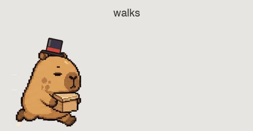
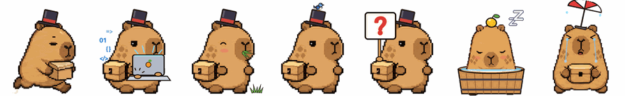

# Capy Plus 🦫 — a capybara pet for Hermes



A calm capybara in a top hat, carrying its cache box, for the [Hermes Agent](https://github.com/NousResearch/hermes-agent) pet.
While idle it munches grass or hosts a little bird on its top hat. While the agent works it thinks, dances, tinkers, juggles oranges or types on a tiny laptop, and it only runs (kicking up dust) when it actually roams the window.
It holds up a "?" sign when Hermes is waiting for you, dozes in a hot-spring tub (yuzu on its head) when you leave it alone, smiles when a job is done, and cries when a tool breaks.
In the desktop app it talks in comic-book speech bubbles: "POW! Nailed it!", "WAAAH! 😭", "ZZZ…".

## Install

```bash
hermes plugins install Lewih/hermes-capy-plus --enable
hermes capy select
```

That's all: it works on current Hermes. Some animations need a newer Hermes, see [What you get](#what-you-get). To update: `hermes plugins update capy-plus`. To uninstall: `hermes plugins remove capy-plus`, then `hermes pets remove capy-plus`.

In the desktop app, also switch on the plugin's desktop half once under **Capabilities → Plugins**. That enables the speech bubbles.

## What you get



Features fall in three groups:

- **Current Hermes**: works today with a stock install.
- **Hermes + [PR #155675](https://github.com/NousResearch/hermes-agent/pull/155675)**: per-pet rows and behaviors in `pet.json`, sleep, wake and pointer handling. The PR is proposed upstream and not merged yet; until then, stock Hermes ignores these fields and nothing breaks.
- **Costumes (hat swaps)**: need a further core change that is **not in Hermes upstream** and not part of that PR. Without it, the mood hats still appear (with PR #155675), they just change without the smoke-puff intro.

| | Current Hermes | + PR #155675 | + costume core patch (not upstream) |
|---|---|---|---|
| Run animations with dust + speed streaks | ✅ | ✅ | ✅ |
| A hat on every frame (top hat by default) | ✅ | ✅ | ✅ |
| Comic speech bubbles: "POW!" on finish, "WAAAH!" on tool errors, "ZZZ…" after 5 min idle, a remark on the tool at work ("sniff sniff 🔍", "*tap tap*", at most one per 45 s), snack breaks at 10/25/50/100 turns a day, a bath after 3 failed tools in a row, coffee in the morning and "go to bed 🌙" after midnight (⌘K → *Capy Plus: toggle comic bubbles* switches to the plain style) | ✅ desktop | ✅ desktop | ✅ desktop |
| ⌘K → **Pet the capybara** | ✅ desktop | ✅ desktop | ✅ desktop |
| **Seasonal top hat**: Santa hat in December, pumpkin around Halloween, straw sun hat + sunglasses in summer (`hermes capy season`) | ✅ | ✅ | ✅ |
| `hermes capy status / select / say / season`, `/capy` in chat | ✅ | ✅ | ✅ |
| **Smiling / crying / waiting-sign sprite animations** (custom rows) | — (extra rows ignored) | ✅ | ✅ |
| **Munches grass / bird visits while idle; thinks / dances / tinkers / juggles / codes while working; runs only when roaming** | — (runs in place, like stock pets) | ✅ | ✅ |
| **Hot-spring nap** (`sleep`) and **poked awake** (`wake`) | — | ✅ | ✅ |
| **Handling**: poked, held, falling, landing ([Interactions](#interactions)) | — | ✅ desktop | ✅ desktop |
| **A hat per mood, swapped in a puff of smoke**: party hat (happy), umbrella (crying), graduation cap (thinking), cowboy hat (dancing), hard hat (tinkering), propeller beanie (juggling), the bird landing on the top hat, a yawn before the hot spring | — | partly: mood hats show, but switch without the smoke intro | ✅ desktop |

The sheet has 34 rows: the 9 standard petdex/Codex rows, then `smiling`, `crying`, `thinking`, `dancing`, `tinkering`, `juggling`, `munching`, `bird`, `onsen`, `sign`, `laptop`, then 9 one-shot costume intros (used only with the costume core patch): 7 hat swaps (`top-hat` … `propeller-hat`), `bird-in` (the bird flies in and lands) and `yawn` (a big yawn, then a poof reveals the tub), then the 4 pointer rows `poked`, `held`, `falling`, `landing`, then `waking` (see [Interactions](#interactions)).
`costumes` groups rows by hat; with the costume core patch, when the hat changes the desktop plays the new hat's intro once. Hosts without it ignore `costumes`.
`pet.json` names every row in `stateRows` and points Hermes pet states at rows in `behaviors`:

```json
"behaviors": {
  "idle":    { "rows": ["idle", "munching", "bird"] },
  "waiting": { "row": "sign" },
  "failed": { "row": "crying" },
  "wave":   { "row": "smiling" },
  "jump":   { "row": "smiling" },
  "review": { "rows": ["thinking"] },
  "run":    { "rows": ["tinkering", "dancing", "juggling", "thinking", "laptop"] },
  "sleep":  { "row": "onsen", "afterSeconds": 300 }
}
```

`rows` lists several rows; the desktop rotates through them every few seconds (terminals show the first).
Keys are Hermes pet states (`idle`, `wave`, `run`, `failed`, `review`, `jump`, `waiting`, the opt-in `sleep`, and the desktop pointer states `poke`, `held`, `fall`, `land`, `wake`).
A behavior whose row the sheet lacks is ignored. Stock Hermes ignores both fields and reads the first 9 rows.

Support for `stateRows` and `behaviors` is proposed upstream as a generic feature in [NousResearch/hermes-agent#155675](https://github.com/NousResearch/hermes-agent/pull/155675). If you run Hermes from a source checkout, you can try it by checking out that PR and rebuilding the desktop app. `costumes` is not part of it.

## Interactions

On desktop builds with pointer interactions (PR #155675), poke the capybara and it squeaks (`>_<`, a "!", then hearts); drag it and it dangles by the scruff.
Let go in mid-air and it flails while falling, its hat lifting off, then lands with a squash, a puff of dust and dizzy stars, and the hat drops back on.
The four rows (`poked`, `held`, `falling`, `landing`) are mapped by the `poke`, `held`, `fall` and `land` behaviors, and all wear the default (or seasonal) top hat.
The bubbles say "SQUEAK!", "Wheee?!" / "Put me down!" and "Oof!" / "*dizzy*", at most one every 1.5 s. Older hosts ignore all of this.
Poke it while it naps and (on hosts with the `wake` state) it plays `waking` instead: eyes snap open, a splash, the yuzu pops off and lands back, then a grumpy 💢 glare, with "Five more minutes… 😾" (or "Wha—? Put me back in the bath!" if you pick it up).

## Seasons

The default top hat (and its `top-hat` intro) changes with the date; mood hats stay the same.

| Season | Dates | Hat |
|---|---|---|
| `halloween` | 20 Oct – 2 Nov | carved pumpkin |
| `winter` | 1 – 31 Dec | Santa hat |
| `summer` | 1 Jul – 31 Aug | straw sun hat + sunglasses |

Each season is a separate sheet in `pet/` (`spritesheet-<season>.webp`, same rows). When the plugin loads, it points the installed `pet.json` at the right sheet, so the switch happens on the next Hermes start after the date changes.

```bash
hermes capy season            # show the current look
hermes capy season auto       # by date (default)
hermes capy season off        # always the top hat
hermes capy season winter     # pin one: winter | halloween | summer
```

`/capy season …` does the same in chat. The choice is stored in `<HERMES_HOME>/plugin-data/capy-plus/settings.json`.

## Remix it

The new rows are composited onto the original frames by a script, so you can tweak the animations:

```bash
uv run --with pillow python tools/make_capy_plus.py tools/source/cache-capy.webp pet   # add --no-hat for a bare capy
for s in winter halloween summer; do uv run --with pillow python tools/make_capy_plus.py tools/source/cache-capy.webp pet --season $s; done
uv run --with pillow python tools/make_preview.py      # refresh assets/preview.gif
hermes capy install                                     # copy to your pets dir
tests/run.sh                                            # offline tests (~1 s)
```

## Layout

```
plugin.yaml          Hermes plugin manifest
__init__.py          installs pet/ into <HERMES_HOME>/pets/capy-plus; `hermes capy`, `/capy`
capy_install.py      staged copy, refreshed only when the files differ; season table + sheet switch
pet/                 pet.json + 34-row spritesheet.webp and spritesheet-<season>.webp (192×208 frames, 8 cols)
desktop/plugin.js    desktop half: bubble reactions + ⌘K command (only while Capy Plus is the active pet)
tools/               sprite generator, preview renderer, source sheet
scripts/test.sh      offline tests
tests/               test suite
```

## Notes

The comic look restyles only this plugin's own speech bubble, by injecting a scoped `<style>` that is removed when the plugin unloads.
It depends on the bubble's markup (`data-pet-plugin`), so `hermes plugins validate` warns about it, and a future Hermes release could change that markup.
If that happens, the bubbles fall back to the normal style.
The popped-out pet overlay window loads no plugin code, so it always shows the normal style.

## Credits & licence

- Base art: **Cache Capy** by [railly](https://github.com/Railly) (Railly Hugo), from the [petdex](https://petdex.dev) gallery ([crafter-station/petdex](https://github.com/crafter-station/petdex)).
- Modifications (hats, seasonal sheets, run dust and all extra rows) by Michele Pugno.
- Art (`pet/*.webp`, `tools/source/*`, preview GIFs) is licensed [CC BY-SA 4.0](https://creativecommons.org/licenses/by-sa/4.0/), see [LICENSE-ART](LICENSE-ART).
- Code is licensed MIT, see [LICENSE](LICENSE).
